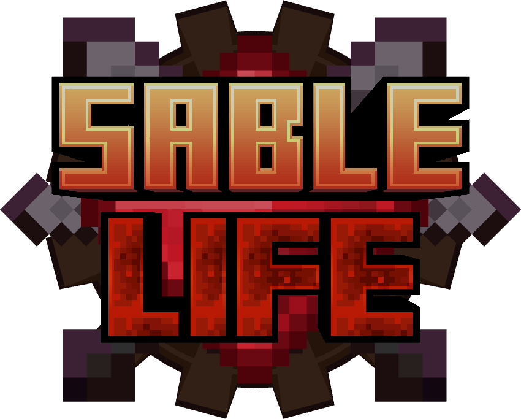

# Sable Life

<p align="center">
  
</p>

**Give your creations life.**

Sable Life is a Minecraft 1.21.1 NeoForge mod built on top of **Create** and **Sable**, designed to work with **Create: Aeronautics** and turn physical structures into configurable living constructs.

Instead of spawning a traditional Minecraft entity, Sable Life gives life directly to the physical structure you build. The blocks themselves form the body and receive damage, while you decide how the construct moves, reacts, attacks, and behaves.

## Current Version

**0.1.313**

Minecraft **1.21.1** · **NeoForge** · **Java 21**

## Requirements

### Required

- Minecraft 1.21.1
- NeoForge 21.1.235 or newer
- Create **6.0.10 or newer, below 6.1** (`[6.0.10,6.1)`)
- Sable **2.0.5 or newer, below 2.1** (`[2.0.5,2.1)`)

### Designed to work with

- Create: Aeronautics **1.3.2** (pinned development version; other versions are not guaranteed)

Create: Aeronautics is part of the primary intended gameplay environment, but is not currently declared as a hard runtime dependency.

## What Sable Life Can Do

A Life can be configured to:

- Track and face targets
- Move, turn, hover, and navigate using configurable behavior
- Perform custom Move Sets and attack sequences
- Use melee attacks, projectiles, lasers, flames, ground strikes, shockwaves, area damage, and more
- React to health phases and combat events
- Use armor, adaptive defense, hit counters, and health adjustment rules
- Communicate through internal channels and Create wireless redstone
- Trigger custom sounds, particles, visual effects, and combat feedback
- Protect its physical body from normal block breaking
- Drop configurable whole-body or limb loot
- Respawn through Arena systems
- Combine multiple modules into custom boss mechanics

## The Structure Is the Body

Sable Life does not rely on a traditional entity-sized hitbox.

The actual physical blocks of the construct form its body. Different sections can function as body parts, attack points, limbs, weapons, sensors, or other mechanical systems.

This allows large or unusually shaped creations to behave more naturally than they would with one invisible entity hitbox.

## Compatibility Notice

Sable Life uses physical block-based bodies rather than traditional Minecraft entity hitboxes. Weapons, spells, or other mechanics specifically designed to damage entity hitboxes may require dedicated compatibility support before they can damage a Life correctly.

Combat integration versions:

| Integration | Version / scope |
| --- | --- |
| Epic Fight | **21.17.3.1**; its bridge is enabled only for this exact version. |
| Iron's Spells 'n Spellbooks | **1.21.1-3.16.3**; its bridge is enabled only for this exact version. |
| TaCZ | Pinned test artifact: **NeoForge 1.1.8-hotfix-r7**, an unofficial Minecraft 1.21.1 port. |
| Create Big Cannons (CBC) | Pinned test version: **5.11.7**, with Ritchie's Projectile Library **2.1.2**. |

The exact-version gates above apply to Epic Fight and Iron's Spells. The TaCZ/CBC entries describe the pinned test environment, not an assertion that every other version works.

Other mods using standard Minecraft damage or block interaction mechanics may work without additional integration, but compatibility is not guaranteed. Even supported integrations may not cover every weapon, spell, addon, or special damage mechanic.

For addon authors, see the [public body combat API guide](docs/COMBAT_API.md) for server-side damage entry points, coordinate conventions and attack cadence.

## Building From Source

Sable Life requires **Java 21**.

On Windows PowerShell:

```powershell
# Restore all compile-time dependencies, including the typed compatibility bridges.
.\scripts\setup-mods.ps1
.\scripts\setup-epicfight.ps1
.\scripts\setup-iron-spells.ps1

# Build the mod.
.\scripts\dev.ps1 -Task build

# Launch the development client.
.\scripts\dev.ps1 -Task runClient

# Run unit tests.
.\scripts\dev.ps1 -Task test

# Run the native GameTest server.
.\scripts\dev.ps1 -Task runGameTestServer
```

The compiled JAR is generated under `build/libs/`.

Epic Fight and Iron's Spells are optional for players, but their JARs are required to compile the typed bridge source. Running the setup scripts does not enable these mods in the default development client. For optional compatibility tests, use the corresponding setup scripts and Gradle properties in `build.gradle`; downloaded dependencies are not bundled into the Sable Life release JAR.

## License

Sable Life is released under the [MIT License](LICENSE).

The NeoForge MDK template material retains its original license in [TEMPLATE_LICENSE.txt](TEMPLATE_LICENSE.txt).

## Disclaimer

Sable Life is an independent mod and is not affiliated with Mojang, Microsoft, Create, Sable, or the authors of compatible third-party mods.

